# Namori 絵日記 · 閲覧と整理

[English](README.md) · [中文](README.zh-CN.md) · [日本語](README.ja.md)

Namori さん（Instagram [@namoridane](https://www.instagram.com/namoridane)）が投稿する毎日の手描き「絵日記」を、閲覧・整理・読み返すための完全に静的なフロントエンドのみのサイトです。中国語名は「水母绘日记」（意味は「クラゲの絵日記」）、ブランド名は **Namori Diary** です。

> アプリの UI は現在中国語のため、本書に登場する UI ラベルは日本語に訳して表記しています。

- **アーカイブは 1,123 枚**（2021-03 → 2025）：うち 1,037 枚が絵日記として確認済み、86 枚が絵日記以外として確認済み
- **1 つのコードベースから 2 つの成果物**：ローカル用の **admin** と、読み取り専用の **public**
- **ローカルファースト**：注釈は `localStorage` に保存され、JSON で持ち運べます。バックエンド・データベース・アカウントは不要
- **既定はダークテーマ**。ライトに切り替えるとブラウザごとに記憶されます
- **PC 優先**。ホーム・カレンダー・ギャラリー・閲覧・詳細はスマートフォン向けレイアウトも用意
- UI は中国語、ブランド行は英語。『ゆるゆり』キャストのプリセットキャラクター 17 体分のプレースホルダーアバター付き

## リンク

- GitHub プロフィール — <https://github.com/payayakamo>
- サイトのリポジトリ — <https://github.com/PayayaKamo/namoridane>
- 小紅書（Xiaohongshu）· PayaYa — <https://xhslink.cn/o/AmThiRAG07o>
- 小紅書（Xiaohongshu）· @PayayaKamo — <https://xhslink.cn/o/22fet2ONRIv>

---

## スクリーンショット

すべて実際に動作しているサイトから取得したもので、モックアップではありません（特記なき限り public ビルド）。

| ホーム | カレンダー |
| --- | --- |
| 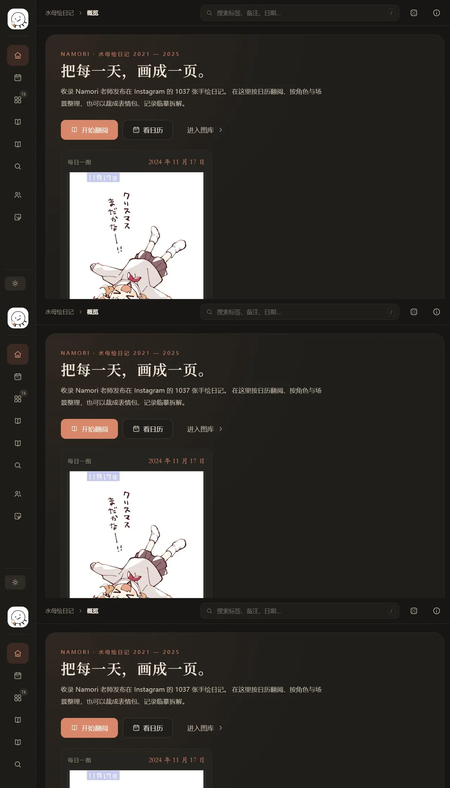 | 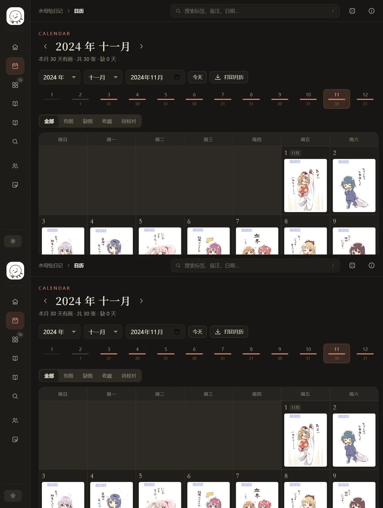 |

| ギャラリー | 詳細（原文キャプション + 元投稿） |
| --- | --- |
| 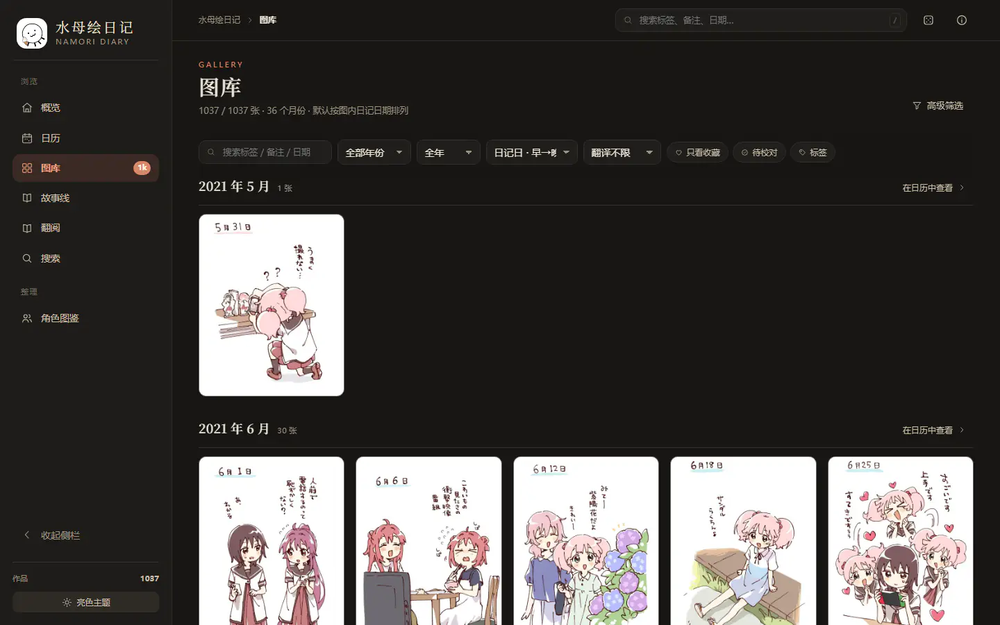 | 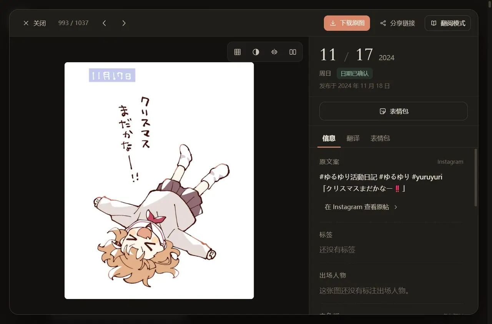 |

| 日付で探す | 閲覧 |
| --- | --- |
| 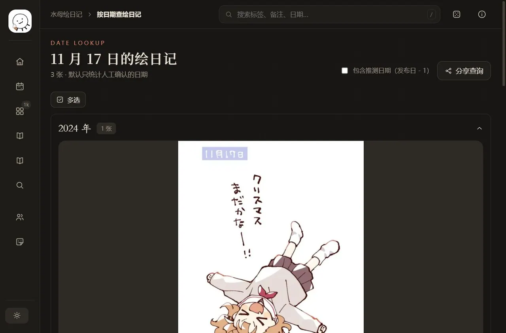 | 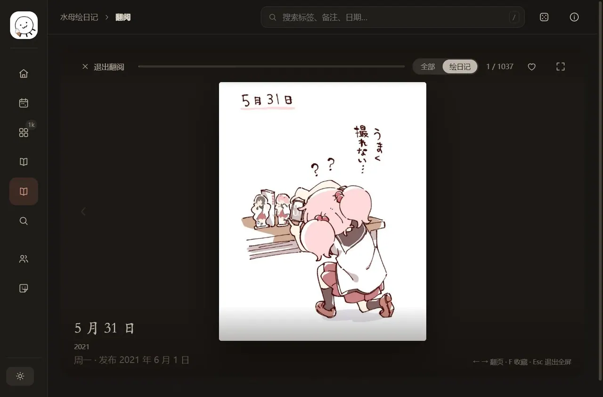 |

| キャラクター図鑑 | ストーリーライン（public の空状態） |
| --- | --- |
| 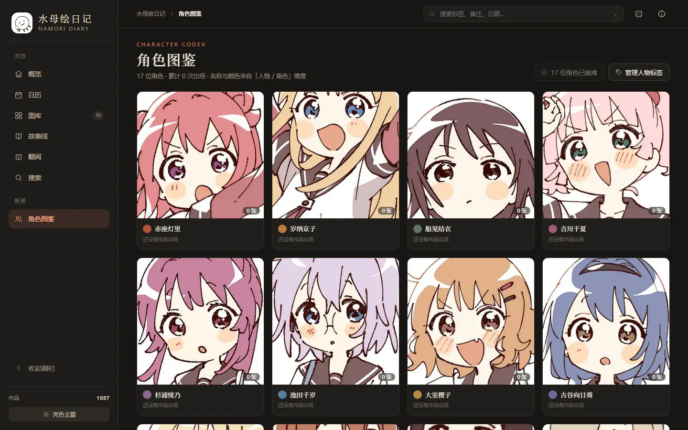 | 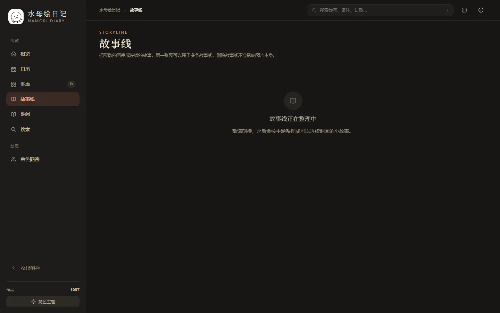 |

| admin · データと書き戻し | スマホ · ホーム | スマホ · カレンダー |
| --- | --- | --- |
| 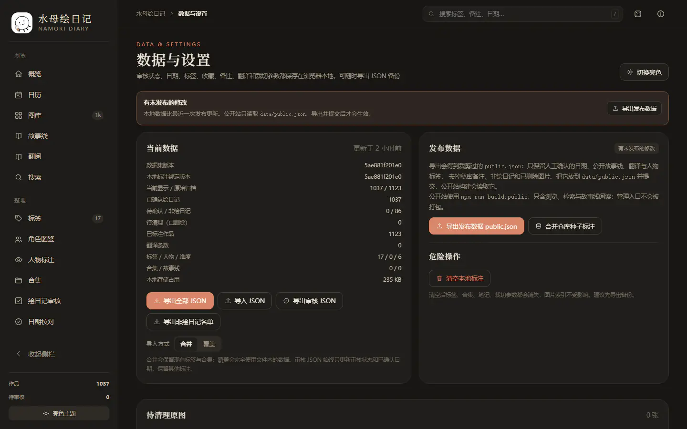 | 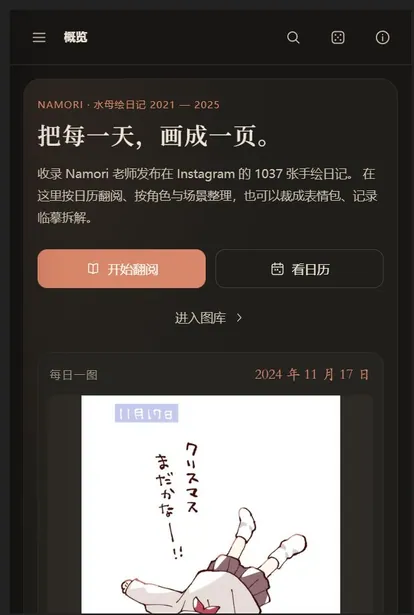 | 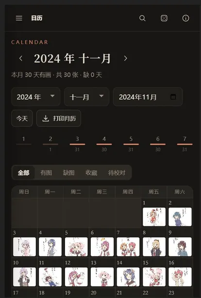 |

> admin のスクリーンショットは書き戻しパネルのみで、メモ・日付校正の下書き・ローカルパスは含みません。

---

## クイックスタート

```bat
:: Windows ワンクリック起動（初回は依存関係のインストール、インデックス生成、ブラウザ起動）
start.cmd
```

または手動で：

```bash
npm install
npm run dev          # インデックスを増分生成して http://localhost:5173/ を起動
npm run build:admin  # ローカル admin -> dist/
npm run build:public # 読み取り専用 public -> dist/
npm run preview      # 直前のビルドをプレビュー
```

Node.js 18+ が必要です。

`images/original/` にアーカイブがコミット済みのため、そのまま完全なサイトが生成されます。空のフォルダでも両方のビルドは成功し、取り込みコマンド付きの「画像はまだありません」空状態を表示します。

### npm スクリプト

| コマンド | 用途 |
| --- | --- |
| `npm run data` | 原本を走査し、サムネイル・大画像・`index.json`・シードを増分生成 |
| `npm run data:force` | キャッシュを無視してすべて再生成 |
| `npm run import -- "<dir>"` | 新しい画像フォルダを取り込み（ハッシュ重複排除・追跡可能な命名） |
| `npm run import:data -- <file.json> --target=public\|review` | エクスポートした JSON を `data/public.json` または `data/userdata.json` へ書き戻す（検証 + バックアップ） |
| `npm run ocr` | 任意・Windows 専用の OCR。レビュー画面の日付候補を事前入力（`data/ocr.json`） |
| `npm run dev` | `data` を実行してから Vite 開発サーバー（admin モード）を起動 |
| `npm run build:admin` | admin ビルド：`data` + 型チェック + `vite build --mode admin` |
| `npm run build:public` | public ビルド：`data --mode=public` + 型チェック + `vite build --mode public` |
| `npm run purge` | `images/_trash/` の原本を完全削除 |
| `npm run preview` | `dist/` をプレビュー |
| `npm run deploy` | `build:public` 後に `dist/` を `gh-pages` ブランチへ push |

---

## 2 つのビルド、1 つのコードベース

`vite build` は `--mode admin|public` を受け取り、モードはコンパイル時定数 `__APP_MODE__` として公開されます。

| | `build:admin` | `build:public` |
| --- | --- | --- |
| 対象 | ローカルの自分用 | GitHub Pages の訪問者 |
| レビュー・手動日付・人物タグ付け | あり | なし |
| タグ / キャラクター / 翻訳の編集 | あり | 読み取り専用 |
| ストーリーライン構築（shortcode 入力含む） | あり | 読み取り専用 |
| コレクション、入出力、除外エリア、一括操作 | あり | なし |
| ローカル JSON 書き戻し | dev サーバーのみ | ビルドに含まれない |
| 未確認の日付 | 推測としてレビュー用に表示 | 確認済みの日付のみ表示 |

admin 専用ビューはコンパイル時のガードで遅延読み込みされるため、public バンドルには admin ルート・フォーム・削除エンドポイント・書き戻しコードが含まれません。非表示は CSS ではなくコンポーネント単位で行っています。

public の空状態は常に訪問者向けの文言（「準備中です。しばらくお待ちください」）で、管理者向けの案内は表示しません。

---

## public サイトへのデータ公開

public ビルドはブラウザのデータを読まず、コミット済みのシード `data/public.json` を読みます。

### 方法 A：admin でエクスポートして書き戻す

1. admin の **データと設定** を開く。
2. **公開データ public.json をエクスポート** で公開用データのみをダウンロード（画像・キャプション・permalink・公開タグ・確認済み日付・Xiaohongshu / WeChat リンク）。
3. 同じページの **data/public.json へ書き込み** でリポジトリへ直接書き込み。`npm run dev`（admin モード）でのみ利用でき、本番ビルドではボタンと dev エンドポイントがコンパイル時に除去されます。
4. **レビューデータを書き込み** は完全なレビューデータを `data/userdata.json` に書き込みます（gitignore 済み・非公開内容を含む）。

書き込み前に必ず `.cache/data-backups/` へバックアップし、検証後にアトミックに書き込みます。書き込み先は `data/` 配下のみで、任意のパスは拒否されます。

### 方法 B：コマンドライン

```bash
npm run import:data -- "C:\Users\me\Downloads\public.json" --target=public
npm run import:data -- "C:\Users\me\Downloads\namori-diary-review.json" --target=review
```

不正または不一致のデータは上書きせずエラーで停止し、書き込み前にバックアップを作成します。

`data/public.json` は公開フィールドのみを保持します。メモ・分解メモ・翻訳下書きは除去され、日付も確認済みのみが出力されます。ローカルデータが最後のエクスポートより新しい場合、admin に **未公開の変更あり** が表示されます。

---

## ディレクトリ構成

```
namoridane/
├─ images/
│  ├─ original/             # 画像アーカイブ（npm run import で置き換え）
│  └─ _trash/               # 削除済みで purge 待ちの原本（gitignored）
├─ data/
│  ├─ public.json           # build:public が使う公開シード（コミット済み）
│  ├─ userdata.json         # 完全なローカルレビューデータ（gitignored）
│  ├─ userdata.example.json # admin シード用の空スキーマ例
│  └─ ocr.json              # 任意の OCR 出力（コミット済み・admin のみ）
├─ docs/screenshots/        # README 用の実スクリーンショット（WebP）
├─ public/
│  ├─ namori_icon.webp      # サイトアイコン（PNG 32/48/180/192 と ICO のフォールバック付き）
│  ├─ characters/           # プリセットキャラクターの 512×512 プレースホルダー
│  ├─ images/thumb/         # 480px WebP サムネイル（生成・gitignored）
│  ├─ images/large/         # 1400px WebP 大画像（生成・gitignored）
│  ├─ images/original/      # ダウンロード用の原本コピー（生成・gitignored）
│  └─ data/index.json       # アイテム索引（生成・gitignored）
├─ scripts/
│  ├─ build-index.mjs       # 原本 → 派生画像 → 索引 → シード
│  ├─ import-images.mjs     # 新しい画像バッチの増分取り込み
│  ├─ import-data.mjs       # エクスポート JSON → data/*.json（検証 + バックアップ）
│  ├─ ocr-dates.mjs         # 任意の日付 OCR（Windows のみ）
│  └─ purge-trash.mjs       # images/_trash を完全削除
├─ src/
│  ├─ components/           # Layout / ItemCard / TagPicker / CharacterPicker / 各エディタ
│  ├─ lib/                  # router、dates、filtering、storage、publish、trash、canvas
│  ├─ state/store.tsx       # グローバル状態 + localStorage 永続化
│  ├─ views/                # home、calendar、gallery、detail、review、date-find、characters、
│  │                        # storylines、translations、stats、data
│  ├─ styles.css
│  └─ styles-views.css
├─ vite.config.ts           # ローカル書き戻し用の dev 専用ミドルウェア
└─ .github/workflows/deploy.yml
```

---

## 機能

| モジュール | 説明 |
| --- | --- |
| ブランドとテーマ | サイトアイコン `namori_icon.webp`（WebP 主体、PNG/ICO フォールバック）。名称は Namori Diary（中国語名は「水母绘日记」）。既定はダークで初回描画のちらつきなし。ライトを選ぶとブラウザごとに記憶 |
| ホーム | 総数と対象年。**今日の一枚は同じ月日・年は不問**（同じ日は決定的に選択）で、カードに「YYYY 年 M 月 D 日」を表示。同月同日がなければ確認済み絵日記の最新へフォールバック。年・タグの概要 |
| カレンダー | サムネイル付き月グリッド。タイトル両側の前年 / 翌年ボタンと `←` / `→` で年を切り替え（月は下のセレクターで指定、入力欄フォーカス時は無効）。月タイトルと統計行をスティッキー表示。最古のデータ年から現在年までの連続した年タブ。初回は内容のある月へ自動移動（まず同月の近い年、次に最も近い月）。手動選択は常に優先 |
| ギャラリー | 月ごとの遅延読み込みメイソンリー。有効日付順。お気に入り / 未確認 / 翻訳状態の絞り込み。複数選択の一括操作（タグ・人物・コレクション・ストーリーライン・原本 ZIP） |
| 詳細 | 大きな画像と前後移動。公開日と日記日付を分離。原文キャプションと permalink。Xiaohongshu / WeChat リンクは値があるときだけ表示。サイズ・容量・ファイル名・shortcode。ダウンロード。タグ・メモ・お気に入り。**登場人物** のチップ選択 |
| 人物タグ付け | `character` タグ次元を再利用：検索可能なチップ、クリックで付け外し、選択済みは先頭でハイライト、`↑`/`↓` + `Enter` のキーボード操作、その場で新規キャラクター作成。ギャラリーの複数選択で同じ人物を一括追加 / 削除。キャラクターページの登場回数は即時更新 |
| キャラクター図鑑 | プリセット 17 体 + 自作キャラクター。名前・色・画像から切り抜いたアバターまたはアップロード。登場回数と最近の登場。キャラクター別ギャラリー |
| 閲覧 | 全画面の連続閲覧、UI 自動非表示、Fullscreen API。セグメント **すべて / 絵日記** は既定が「絵日記」で、手動変更後は記憶。範囲切替時は最も近い項目へ移動し、空白になりません |
| 日付で探す | 検索欄に `20261117`、`2026-11-17`、`11-17`、`11/17` を入力、またはカレンダーの日をクリック。結果は縦 1 列のカード：日付と曜日、公開日、コピー可能な shortcode、permalink、折りたたみ可能なキャプション、Xiaohongshu / WeChat リンク。同年同日が複数年にまたがる場合は年ごとに縦並び。複数選択と共有ハッシュ |
| ストーリーライン | カバー・タイトル・説明・枚数・日付範囲・最終更新のカード。**shortcode でストーリーライン作成**（改行・空白・カンマ・完全な Instagram リンク、重複は警告、作成前に順序と未一致をプレビュー、作成後に並べ替え可能）。章メモ・カバー・タグ・連続 / スライド閲覧・JSON/HTML 出力 |
| 絵日記レビュー | 未審査 / 絵日記 / 非絵日記 / すべてのキュー。大画像レビュー。OCR 候補と切り抜きプレビュー。推定日付 = 公開日 − 1 日。ワンキー確認。`N` で非絵日記。`←`/`→` でページ送り。進捗と残数。レビュー JSON のエクスポート |
| OCR | `npm run ocr` が画面に書かれた日付を読み取り `data/ocr.json` を生成。レビュー画面に最大 3 候補と信頼度を表示。Windows のみ・任意で、明瞭な日付文字に限られます |
| 検索と絞り込み | キーワード（タグ / メモ）、日付範囲、年 / 月、コレクション、お気に入り、翻訳状態。次元内 AND/OR。public ではメモ系と「未校正のみ」のコントロールを非表示 |
| タグ | 5 つの組み込み次元 + カスタム次元。作成・編集・削除、色、使用数、一括タグ付け |
| 翻訳 | 日本語原文 + 多言語スロット。校正用の OCR 下書き。翻訳済み / 未翻訳の絞り込み。CSV/JSON 入出力 |
| コレクション | 名前付きコレクション、複数選択で追加、ドラッグ並べ替え、カバー、閲覧、md/json/csv 出力 |
| 模写分解 | 構図 / 配色 / 線 / 表情のメモ、自動パレット、類似画像の提案 |
| 統計 | 総数、作画日数、最長連続、レビュー進捗。月別バー、年別概要、タグと色の分布 |
| データと設定 | 完全な JSON 入出力、レビュー JSON、翻訳 CSV/JSON、公開シードのエクスポート、**dev 専用の書き戻し**、クリーンアップ待ち一覧、リセット、スキーマとショートカット |
| スマホ向けレイアウト | 折りたたみ可能な上部検索、サムネイルが見えるコンパクトなカレンダー、全幅で等分される閲覧セグメント、固定 100vh を使わない、タップ時の青いハイライトなし |

### キーボードショートカット

| キー | 動作 |
| --- | --- |
| `←` / `→` | 詳細と閲覧で前 / 次。カレンダーで前年 / 翌年（入力欄フォーカス時は無効） |
| `Esc` | 詳細・モーダル・スマホ検索パネルを閉じる |
| `/` | グローバル検索にフォーカス |
| `R` | ランダムに 1 枚 |
| `F` | 現在の画像をお気に入り |
| `Enter` | レビューで確認して次へ。選択 UI では入力名で作成 / 追加 |
| `N` | レビューで非絵日記としてマーク |
| `1` / `2` | 詳細タブ：情報 / 模写 |
| `?` | ショートカットパネル |

---

## 画像の出所と命名

`scripts/build-index.mjs` は次の順でソースディレクトリを解決します：

1. CLI 引数：`--src="D:\path\to\images"`
2. 環境変数：`NAMORI_SRC`
3. リポジトリのアーカイブ：`images/original/`（空なら自動作成）

ファイル名は追跡可能である必要があります：

```
YYYY-MM-DD-<11 文字の shortcode>[-n].jpg
unknown-<元のファイル名>.jpg
```

接頭辞は Instagram の **公開日**（`publishedAt`）。複数画像の投稿は `-0 / -1 / …` の接尾辞を使い、`postCount` と安定した `id` を計算します。原文キャプションは `caption`、元投稿リンクは shortcode から生成します。

### 日付ルール

- 公開日はファイル名から取得します。
- 画面に手書きされた日記の日付は **人が確認** します。黙って推測しません。
- OCR は信頼度付きの候補を最大 3 つ提示し、年は公開日に最も近い値で推定します。OCR はヒントであり事実ではありません。
- 有効な OCR 結果がない場合、レビュー画面は **公開日 − 1 日** を **推定** として事前入力します（月・年の境界も正しく繰り上げ）。
- 確認済みの日付のみが `data/public.json` に入ります。public は推測を日付として提示しません。

---

## データ構造

### 1. アイテム索引 — `public/data/index.json`

ビルドが生成し、フロントエンドは読み取り専用：

```jsonc
{
  "version": 7,
  "generatedAt": "2026-11-17T00:00:00.000Z",
  "datasetId": "…",
  "count": 1123,
  "years": { "2021": 258, "2022": 401, "2023": 155, "2024": 308, "2025": 1 },
  "items": [
    {
      "id": "2021-06-01-CPlLQUStuZq",
      "shortcode": "CPlLQUStuZq",
      "file": "2021-06-01-CPlLQUStuZq.jpg",
      "postIndex": 0,
      "postCount": 1,
      "publishedAt": "2021-06-01",
      "dateKnown": true,
      "inferredYear": 2021,
      "inferredMonth": 5,
      "inferredDay": 31,
      "caption": "#ゆるゆり活動日記 …",
      "thumb": "images/thumb/2021-06-01-CPlLQUStuZq.webp",
      "large": "images/large/2021-06-01-CPlLQUStuZq.webp",
      "original": "images/original/2021-06-01-CPlLQUStuZq.jpg",
      "w": 1080,
      "h": 1350,
      "color": "#e8dccb",
      "ocr": { "rawText": "5月31日", "candidates": [] },
      "suggestedDiaryDate": { "year": 2021, "month": 5, "day": 31 }
    }
  ]
}
```

public モードでは `inferred*`・`ocr`・`suggestedDiaryDate` を除去しますが、`caption` と `shortcode` は詳細ページ用に残します。

### 2. ユーザーデータ v2 — `localStorage` / 入出力

ストレージキー：`namori.diary.userdata.v2`。型定義は [`src/types.ts`](src/types.ts)。

```jsonc
{
  "version": 2,
  "datasetId": "…",
  "dimensions": [{ "id": "character", "name": "人物/キャラクター", "order": 0, "builtIn": true }],
  "tags": [{ "id": "t_xxx", "name": "赤座灯里", "dimensionId": "character", "color": "#c96f4a" }],
  "characters": [{ "id": "t_xxx", "avatarItemId": "…", "avatarCrop": { "cx": 0.5, "cy": 0.5 } }],
  "collections": [{ "id": "c_xxx", "name": "模写参考", "itemIds": ["…"] }],
  "storylines": [{
    "id": "story_xxx",
    "title": "夏の一週間",
    "blocks": [
      { "id": "block_1", "type": "image", "itemId": "…" },
      { "id": "block_2", "type": "note", "text": "第 2 章：雨の日" }
    ],
    "published": true
  }],
  "items": {
    "2021-06-01-CPlLQUStuZq": {
      "tags": ["t_xxx"],
      "favorite": true,
      "reviewed": true,
      "excluded": false,
      "note": "非公開メモ",
      "date": { "year": 2021, "month": 5, "day": 31, "confirmed": true, "source": "manual" },
      "study": { "composition": "", "palette": "", "memo": "" }
    }
  }
}
```

- レビュー状態は `reviewed` + `excluded`：`false/false` 未審査、`true/false` 絵日記、`true/true` 非絵日記。
- `deleted` はすべてのビューと公開シードから除外し、原本は `images/_trash/` へ移動します。
- `date.source` は `inferred` / `published` / `manual`。`confirmed: true` のみ public に表示されます。
- 登場人物は `character` 次元の通常タグで、並行する別データはありません。

上記のサンプル値は説明用です。実際のデータには入力した名前がそのまま入ります。

### データセットのバージョンとリセット

`index.json` はファイル一覧とバイト数から作られた `datasetId` を持ちます。id が変わると（新しい取り込み・画像削除）、アプリは以前の注釈を破棄して新規に開始します。**データと設定 → ローカル注釈を消去** でいつでもリセットできます。公開シードに `datasetId` はなく、public 側が読み込み後に公開索引へ紐づけます。

---

## 増分ビルド

- キャッシュ：`.cache/images.json`、キーは `file:target-size:mtime`。
- `npm run data` を再実行すると未変更の画像を再利用し、通常 1 秒程度で完了します。
- `npm run data:force` で強制再生成。
- レビューや注釈は画像アーカイブに触れません。索引が変わるのはソースファイルを増減したときだけです。

---

## 新しい画像バッチの追加

```bash
npm run import -- "C:\path\to\new\images"
```

通常の画像フォルダと **Instagram 保存ページのディレクトリ** の両方に対応します。

1. `.jpg` / `.jpeg` を再帰走査し、ページ資材や PNG/WebP の UI 画像は無視します。
2. 埋め込みページ JSON、GraphQL レスポンス、base64 `_DataURI` から `shortcode`・`taken_at`・画像 URL・キャプションを解析します。
3. 重複排除はファイル内容の SHA-256。既存ファイルやバッチ内重複はスキップします。
4. 日付を復元できない画像は `unknown-<shortcode>.jpg` となり、手入力待ちとして残ります。
5. ファイルをコピーするだけで、ソースディレクトリは変更しません。同じフォルダの再取り込みは冪等です。

その後 `npm run data`（またはビルド）で派生画像を生成し、索引を更新します。

---

## 絵日記の日付レビュー（原本は変更しません）

1. admin で **絵日記レビュー**（`#/diary-review`）を開く。
2. OCR 結果があれば候補を、なければ **公開日 − 1 日** を **推定** として事前入力。
3. `Enter` で確認して次へ、`N` で非絵日記、`←` / `→` でページ送り。
4. 進捗行に確認済み / 総数と残数を表示。
5. レビュー JSON をエクスポートしてバックアップ・復元できます。インポートはレビュー状態と確認済み日付のみを更新します。
6. 結果は **data/public.json へ書き込み** / **レビューデータを書き込み**（dev）または `npm run import:data` で書き戻します。

この流れで原本を切り抜く・改名する・上書きする・削除することはありません。

---

## 無関係な画像の削除

1. 詳細ページまたはギャラリーの複数選択で **削除** を押す。
2. 確認モーダルの後、すべてのビューと公開シードから即座に消え、原本は `images/_trash/` へ移動します。
3. 短期間は **元に戻す** トーストで復元できます。
4. **データと設定 → クリーンアップ待ちの原本** で個別に **復元**、または **クリーンアップを実行** で完全削除（`npm run purge` でも可）。

public ビルドには削除エンドポイントも削除コードパスも含まれません。

---

## GitHub Pages へのデプロイ

リポジトリ：<https://github.com/PayayaKamo/namoridane.git>

`vite.config.ts` は `base: './'` を使うため、`https://<user>.github.io/<repo>/` 配下でそのまま動作します。

`.github/workflows/deploy.yml` は `main` への push ごとに `npm run build:public` を実行し `dist/` を公開します。

1. リポジトリの **Settings → Pages → Build and deployment → Source** で **GitHub Actions** を選択。
2. `main` を push してワークフローの完了を待つ。
3. <https://payayakamo.github.io/namoridane/> を開く。

push 前に `data/public.json` がコミットされていることを確認してください。ない場合 public ビルドにデータが入りません。

---

## 注意と制限

- OCR は任意かつ Windows 専用（PowerShell WinRT、追加依存なし）。レビュー補助であり、日付は必ず人が確認します。
- Instagram のコメントは取得していません。コメントを捏造せず、空のコメント欄も残しません。
- 日付は確認後にのみ公開され、推測が事実として表示されることはありません。
- デプロイ成果物は原本と WebP 派生画像を含み約 260 MB です。軽くしたい場合は `scripts/build-index.mjs` で大画像サイズを下げるか原本を外してください（ダウンロード機能は失われます）。

---

## 著作権

すべてのイラストの著作権は Namori さんに帰属します。本リポジトリは個人の閲覧・学習・模写参考のためのもので、商用利用や原本の再配布は行わないでください。

## ライセンス

本リポジトリのソースコードは [MIT ライセンス](LICENSE) で公開されています。イラストと原本の著作権は Namori さんに帰属し、このライセンスの**対象外**です。原本の再配布は行わないでください。
