# Namori Diary

[English](README.md) · [中文](README.zh-CN.md) · [日本語](README.ja.md)

> The application UI is currently in Chinese, so UI labels quoted here are translated into English. The site's Chinese name is 水母绘日记 ("Jellyfish Illustrated Diary"), and the brand line stays **Namori Diary**.

A fully static, front-end-only site for browsing, curating and re-reading the daily sketches ("絵日記") that **Namori** ([@namoridane](https://www.instagram.com/namoridane)) posts on Instagram.

- **1,123 images in the archive** (2021-03 → 2025): 1,037 confirmed diary pages and 86 images reviewed as non-diary
- **Two builds from one codebase**: a full local **admin** app and a read-only **public** site
- **Local-first**: annotations live in `localStorage` and travel as JSON; there is no backend, database or account
- **Default dark theme**, light theme available and remembered per browser
- **PC-first**, with phone layouts for home, calendar, gallery, reading and detail pages
- Chinese UI with the English brand line **Namori Diary**; 17 placeholder character avatars from the *Yuru Yuri* cast

## Links

- GitHub profile — <https://github.com/payayakamo>
- Site repository — <https://github.com/PayayaKamo/namoridane>
- Xiaohongshu · PayaYa — <https://xhslink.cn/o/AmThiRAG07o>
- Xiaohongshu · @PayayaKamo — <https://xhslink.cn/o/22fet2ONRIv>

---

## Screenshots

All screenshots are taken from the running site (public build unless noted), not mockups.

| Home | Calendar |
| --- | --- |
| 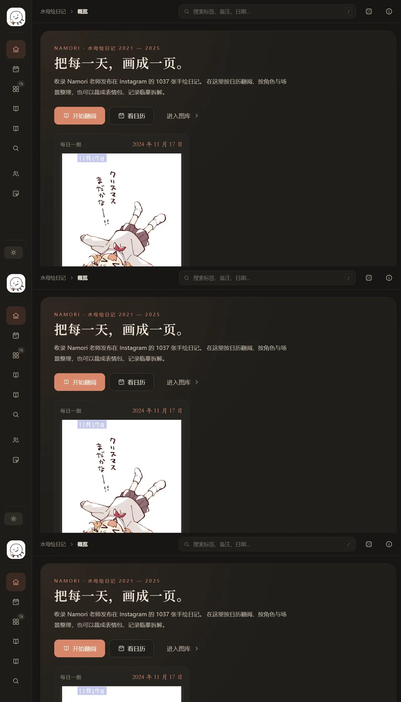 | 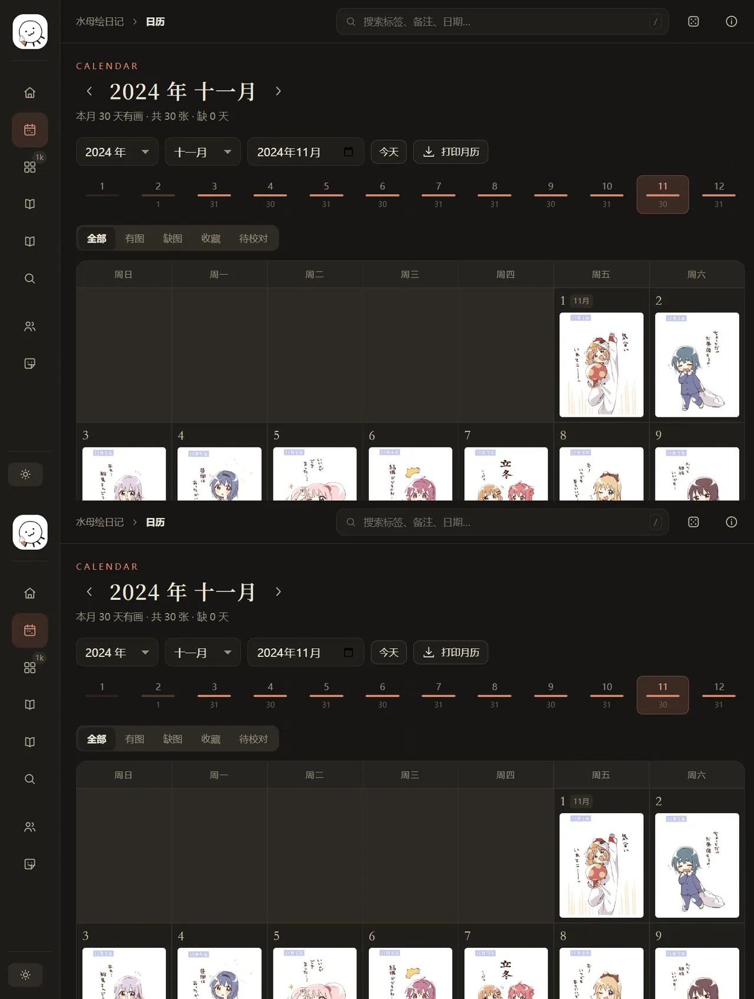 |

| Gallery | Detail (caption + original post) |
| --- | --- |
| 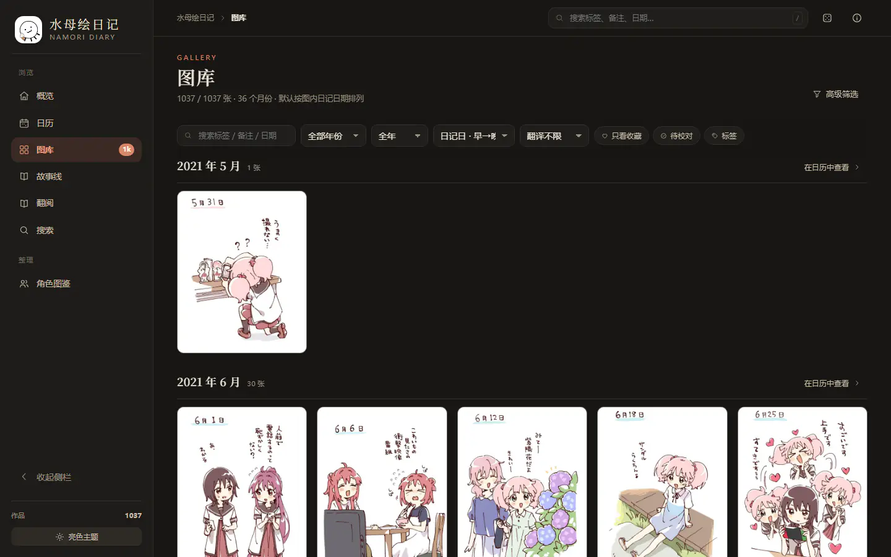 | 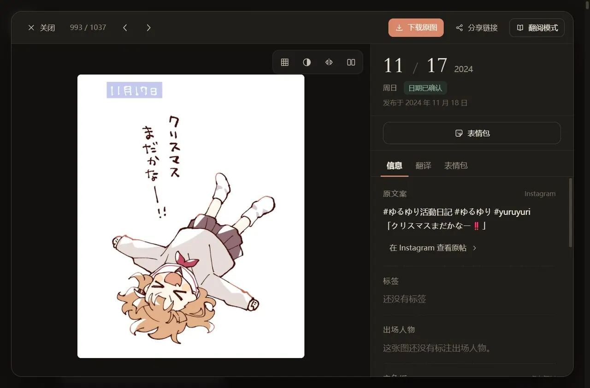 |

| Find by date | Reader |
| --- | --- |
| 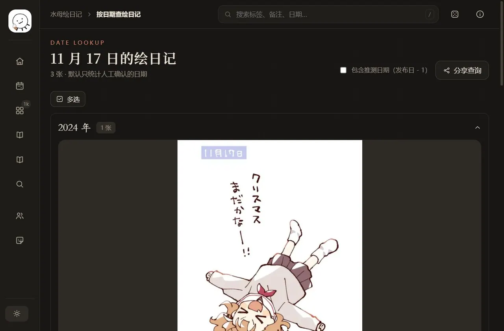 | 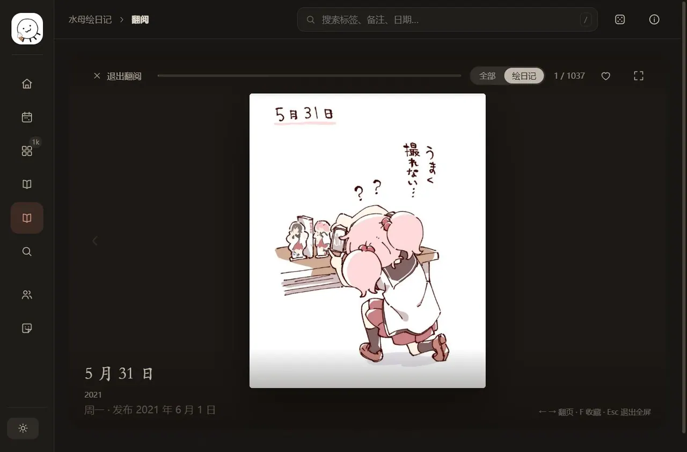 |

| Characters | Storylines (public empty state) |
| --- | --- |
| 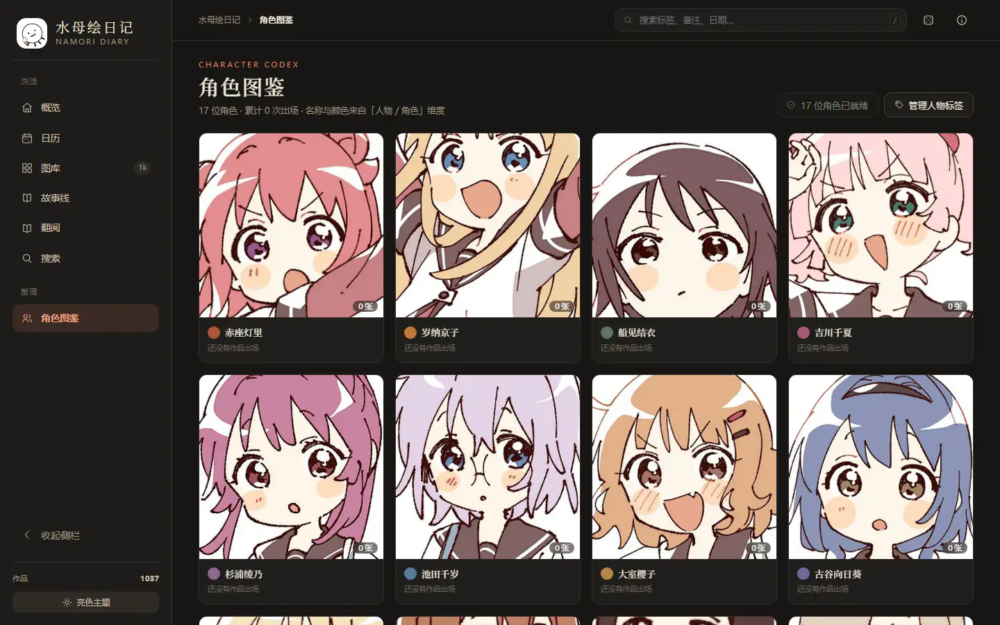 | 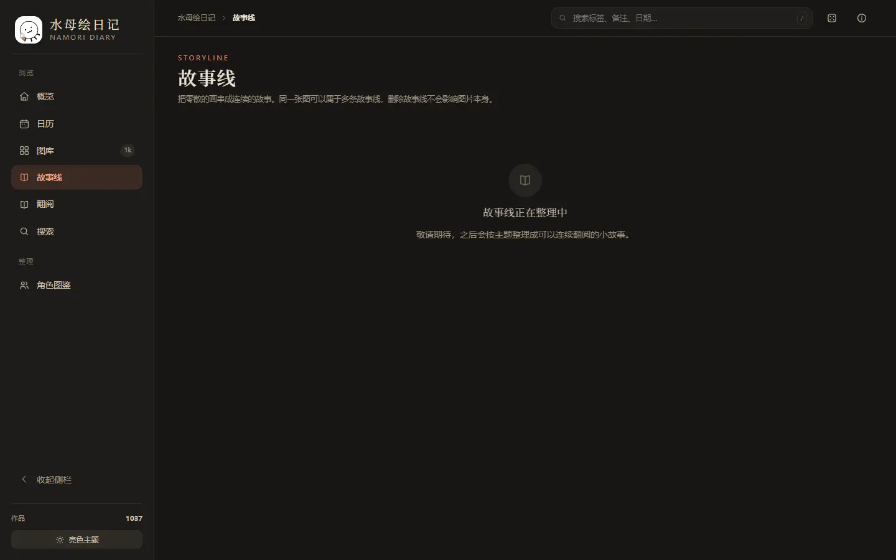 |

| Admin · data & write-back | Phone · home | Phone · calendar |
| --- | --- | --- |
| 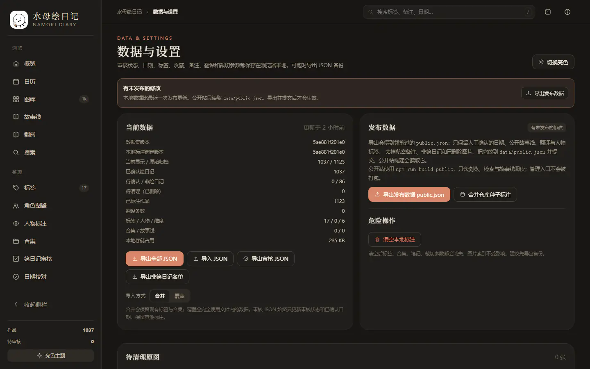 | 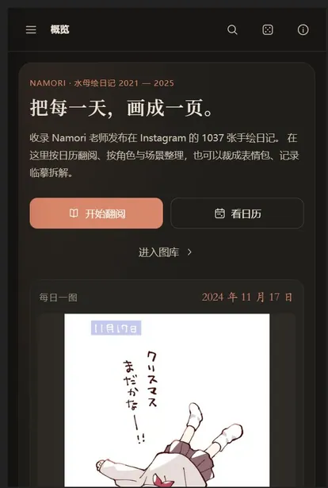 | 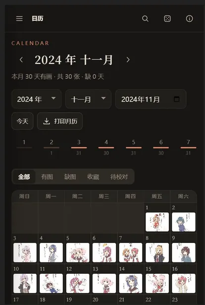 |

> The admin screenshot only shows the write-back panel: no notes, date drafts or local paths.

---

## Quick start

```bat
:: Windows one-click launcher (installs deps, builds the index, opens the browser on first run)
start.cmd
```

Or manually:

```bash
npm install
npm run dev          # build the index incrementally, then serve http://localhost:5173/
npm run build:admin  # local admin app  -> dist/
npm run build:public # read-only public site -> dist/
npm run preview      # preview the last build
```

Requires Node.js 18+.

The committed archive in `images/original/` already produces a full site. With an empty folder both builds still succeed and the site shows a clear "No images yet" empty state with the import command.

### npm scripts

| Command | Purpose |
| --- | --- |
| `npm run data` | Scan originals; incrementally generate thumbnails, large images, `index.json` and seed data |
| `npm run data:force` | Rebuild every derivative, ignoring the cache |
| `npm run import -- "<dir>"` | Import a new image folder: hash dedupe, traceable naming, merged into `images/original/` |
| `npm run import:data -- <file.json> --target=public\|review` | Write an exported JSON back into `data/public.json` or `data/userdata.json` (validated, with backup) |
| `npm run ocr` | Optional Windows-only OCR that pre-fills date hints for the review page (`data/ocr.json`) |
| `npm run dev` | Run `data` then start the Vite dev server (admin mode) |
| `npm run build:admin` | Admin build: `data` + type check + `vite build --mode admin` |
| `npm run build:public` | Public build: `data --mode=public` + type check + `vite build --mode public` |
| `npm run purge` | Permanently delete files waiting in `images/_trash/` |
| `npm run preview` | Preview `dist/` |
| `npm run deploy` | `build:public` then push `dist/` to the `gh-pages` branch |

---

## Two builds, one codebase

`vite build` receives `--mode admin|public`; the mode is exposed as the compile-time constant `__APP_MODE__`.

| | `build:admin` | `build:public` |
| --- | --- | --- |
| Audience | You, locally | Visitors, on GitHub Pages |
| Review, manual dates, character tagging | Yes | No |
| Tag / character / translation editing | Yes | Read-only display |
| Storyline building (including shortcode builder) | Yes | Read-only reading |
| Collections, import/export, excluded area, batch ops | Yes | No |
| Local JSON write-back | Dev server only | Not compiled in |
| Unconfirmed dates | Shown as guesses for review | Only confirmed dates are shown |

Admin-only views are lazy-loaded behind a compile-time guard, so the public bundle contains no admin routes, forms, delete endpoints or local write-back code. Hiding is done at the component level, not with CSS.

Public empty states always use visitor-facing copy ("In preparation, stay tuned"), never admin instructions.

---

## Publishing data to the public site

The public build never reads your browser data. It reads the committed seed `data/public.json`.

### Option A — export and write back in the admin app

1. Open **Data & settings** in the admin app.
2. **Export public data public.json** downloads a public-only file (browse data: images, captions, permalinks, public tags, confirmed dates, Xiaohongshu / WeChat links).
3. In the same page, **Write to data/public.json** stores it straight into the repository — available only in `npm run dev` (admin mode); the button and its dev-server endpoint are compiled out of production builds.
4. **Write review data** writes the full review store to `data/userdata.json`, which is gitignored and contains private notes.

Every write first copies the previous file to `.cache/data-backups/`, then validates the payload and writes atomically. Only files inside `data/` can be targeted; arbitrary paths are rejected.

### Option B — command line

```bash
npm run import:data -- "C:\Users\me\Downloads\public.json" --target=public
npm run import:data -- "C:\Users\me\Downloads\namori-diary-review.json" --target=review
```

Invalid or mismatched payloads fail loudly instead of overwriting the current file; a backup is created first.

`data/public.json` keeps only public fields. Notes, study notes and translation drafts are stripped, and only confirmed diary dates are exported. The admin page shows **Unpublished changes** whenever local data is newer than the last export.

---

## Project layout

```
namoridane/
├─ images/
│  ├─ original/             # image archive (replaced by npm run import)
│  └─ _trash/               # deleted originals waiting for purge (gitignored)
├─ data/
│  ├─ public.json           # published seed used by build:public (committed)
│  ├─ userdata.json         # full local review store (gitignored)
│  ├─ userdata.example.json # empty schema example for the admin seed
│  └─ ocr.json              # optional OCR output (committed, admin only)
├─ docs/screenshots/        # real screenshots used by the READMEs (WebP)
├─ public/
│  ├─ namori_icon.webp      # site icon (plus PNG 32/48/180/192 and ICO fallbacks)
│  ├─ characters/           # 512×512 placeholder avatars for preset characters
│  ├─ images/thumb/         # 480px WebP thumbnails (generated, gitignored)
│  ├─ images/large/         # 1400px WebP large images (generated, gitignored)
│  ├─ images/original/      # originals copied for download (generated, gitignored)
│  └─ data/index.json       # item index (generated, gitignored)
├─ scripts/
│  ├─ build-index.mjs       # originals → derivatives → index → seed
│  ├─ import-images.mjs     # incremental import for new image batches
│  ├─ import-data.mjs       # exported JSON → data/*.json (validated, backed up)
│  ├─ ocr-dates.mjs         # optional date OCR (Windows only)
│  └─ purge-trash.mjs       # permanently empty images/_trash
├─ src/
│  ├─ components/           # Layout / ItemCard / TagPicker / CharacterPicker / editors ...
│  ├─ lib/                  # router, dates, filters, storage, publish, trash, canvas
│  ├─ state/store.tsx       # global state + localStorage persistence
│  ├─ views/                # home, calendar, gallery, detail, review, date-find, characters,
│  │                        # storylines, translations, stats, data
│  ├─ styles.css
│  └─ styles-views.css
├─ vite.config.ts           # dev-only middleware for local write-back
└─ .github/workflows/deploy.yml
```

---

## Features

| Module | Description |
| --- | --- |
| Brand & theme | Site icon `namori_icon.webp` (WebP first, PNG/ICO fallbacks); name Namori Diary; dark theme by default with no first-paint flash, light theme remembered once chosen |
| Home | Archive totals and coverage years; **daily pick = same month & day in any year** (deterministic per day), labelled with its full date, falling back to the latest confirmed diary page; editorial year/tag overview |
| Calendar | Month grid with thumbnails; previous/next **year** buttons beside the title and `←` / `→` keys (ignored inside inputs); months are chosen with the picker below; sticky month title and stats line; continuous year tabs from the earliest data year to the current year; first visit auto-lands on a month that has content (same month in a closer year first, then the nearest month) while manual choices always win |
| Gallery | Lazy masonry grouped by month; effective-date ordering; favourite/pending filters; translation filter; multi-select batch actions (tags, characters, collections, storylines, ZIP of originals) |
| Detail | Large image with previous/next; publish date and diary date separated; original caption and permalink; Xiaohongshu / WeChat jump links shown only when present; dims, size, file, shortcode; download; tags, note, favourite; **Cast** chip picker for cast tagging |
| Cast tagging | Reuses the `character` tag dimension: searchable chips, click to tag or untag, selected characters float to the top and stay highlighted, `↑`/`↓` + `Enter` keyboard support, create a new character inline; gallery multi-select can add or remove the same cast in bulk; character page stats update immediately |
| Characters | 17 preset avatars plus your own; name, colour, avatar cropped from an image or uploaded; appearance counts and recent appearances; gallery grouped by character |
| Reader (browse) | Full-screen sequential reading, UI auto-hide and the Fullscreen API; segmented **All / Diary** with Diary as the default (remembered after a manual switch); switching scope jumps to the nearest item instead of going blank |
| Find by date | Type `20261117`, `2026-11-17`, `11-17` or `11/17` in search, or click a calendar day. Results are a single-column card flow: date and weekday, publish date, copyable shortcode, permalink, collapsible caption, Xiaohongshu / WeChat links; multi-year hits stack by year; multi-select and shareable hash |
| Storylines | Cards with cover, title, description, image count, date range and last edit; **build a storyline from a shortcode list** (newlines, spaces, commas or full Instagram links; duplicates are reported; preview with order numbers and unmatched codes; reorder after creation); chapter notes, cover, tags, continuous or slide reader, JSON/HTML export |
| Diary review | Pending / diary / non-diary / all queues; large-image review; OCR candidates and crop preview; inferred date = publish date − 1 day; one-key confirm; `N` marks non-diary; `←`/`→` paging; progress and remaining count; export review JSON |
| OCR | `npm run ocr` reads dates written on the page, writes `data/ocr.json`, and the review page shows up to three candidates with confidence; Windows-only, optional, limited to clear handwritten/printed dates |
| Search & filter | Keyword (tags / notes), date range, year/month, collection, favourites, translation status; per-dimension AND/OR; public build hides note-based and unconfirmed-only controls |
| Tags | Five built-in dimensions plus custom ones; create/edit/delete, colours, usage counts, batch tagging |
| Translations | Japanese source plus multi-language slots; OCR draft kept for proofreading; translated/untranslated filters; CSV/JSON export and import |
| Collections | Named collections, multi-select add, drag reorder, cover, browse, export as md/json/csv |
| Study mode | Composition / palette / linework / expression notes, automatic palette, similar-image recommendations |
| Stats | Totals, drawing days, longest streak, review progress; monthly bars, yearly overview, tag and colour distribution |
| Data & settings | Full JSON export/import, review JSON, translation CSV/JSON, public seed export, **dev-only write-back**, pending-cleanup list, reset, schema and shortcuts |
| Phone layout | Collapsible top search, compact calendar with visible thumbnails, full-width segmented reader control, no fixed 100vh, no blue tap highlight on touch |

### Keyboard shortcuts

| Key | Action |
| --- | --- |
| `←` / `→` | Previous / next item in detail and reader; previous / next year on the calendar (when an input is not focused) |
| `Esc` | Close detail, modal, or the mobile search panel |
| `/` | Focus the global search |
| `R` | Random item |
| `F` | Favourite the current item |
| `Enter` | Confirm and advance in the review page; add a shortcode or create a character in the pickers |
| `N` | Mark non-diary in the review page |
| `1` / `2` | Detail tabs: info / study |
| `?` | Shortcut panel |

---

## Image source and naming

`scripts/build-index.mjs` resolves the source directory in this order:

1. CLI argument: `--src="D:\path\to\images"`
2. Environment variable: `NAMORI_SRC`
3. Repository archive: `images/original/` (created automatically when empty)

File names must be traceable:

```
YYYY-MM-DD-<11-char shortcode>[-n].jpg
unknown-<original-filename>.jpg
```

The date prefix is the Instagram **publish date** (`publishedAt`). Multi-image posts use a `-0 / -1 / …` suffix; the pipeline computes `postCount` and a stable `id`. The original Instagram caption is stored as `caption` and the post URL is derived from the shortcode.

### Date rules

- The publish date comes from the file name.
- The hand-written diary date on the page is **confirmed by a human**, never guessed silently.
- OCR can suggest up to three candidates with confidence, with the year inferred nearest to the publish date. OCR output is a hint, not a fact.
- If there is no usable OCR result, the review page pre-fills **publish date − 1 day** and labels it clearly as **Estimated** (crossing month and year boundaries correctly).
- Only confirmed dates are exported to `data/public.json`. The public site never presents a guess as a date.

---

## Data schema

### 1. Item index — `public/data/index.json`

Generated, read-only for the front end:

```jsonc
{
  "version": 9,
  "generatedAt": "2026-11-17T00:00:00.000Z",
  "datasetId": "…",
  "count": 1123,
  "years": { "2021": 258, "2022": 401, "2023": 155, "2024": 308, "2025": 1 },
  "items": [
    {
      "id": "2021-06-01-CPlLQUStuZq",
      "shortcode": "CPlLQUStuZq",
      "file": "2021-06-01-CPlLQUStuZq.jpg",
      "postIndex": 0,
      "postCount": 1,
      "category": "diary",                 // "diary" = confirmed diary page, "other" = reviewed as non-diary
      "includedInPublic": true,            // false for the 86 images reviewed as non-diary
      "publishedAt": "2021-06-01",
      "dateKnown": true,
      "inferredYear": 2021,
      "inferredMonth": 5,
      "inferredDay": 31,
      "caption": "#ゆるゆり活動日記 …",          // original Instagram caption, kept verbatim
      "thumb": "images/thumb/2021-06-01-CPlLQUStuZq.webp",
      "large": "images/large/2021-06-01-CPlLQUStuZq.webp",
      "original": "images/original/2021-06-01-CPlLQUStuZq.jpg",
      "w": 1080,
      "h": 1350,
      "color": "#e8dccb",
      "ocr": { "rawText": "5月31日", "candidates": [] },   // text read from the page, kept verbatim
      "suggestedDiaryDate": { "year": 2021, "month": 5, "day": 31 }
    }
  ]
}
```

`category` / `includedInPublic` come from the review conclusions in `data/public.json` (`excludedIds`): the admin build keeps all 1,123 items, while the public build filters out every item with `includedInPublic: false` and therefore indexes only the 1,037 confirmed diary pages.

In public mode, `inferred*`, `ocr` and `suggestedDiaryDate` are stripped; `caption` and `shortcode` stay so the detail page can show the original text and link.

### 2. User data v2 — `localStorage` / import-export

Storage key: `namori.diary.userdata.v2`. Full types: [`src/types.ts`](src/types.ts).

```jsonc
{
  "version": 2,
  "datasetId": "…",
  "dimensions": [{ "id": "character", "name": "People/Characters", "order": 0, "builtIn": true }],
  "tags": [{ "id": "t_xxx", "name": "Akaza Akari", "dimensionId": "character", "color": "#c96f4a" }],
  "characters": [{ "id": "t_xxx", "avatarItemId": "…", "avatarCrop": { "cx": 0.5, "cy": 0.5 } }],
  "collections": [{ "id": "c_xxx", "name": "Copy practice", "itemIds": ["…"] }],
  "storylines": [{
    "id": "story_xxx",
    "title": "A week in summer",
    "blocks": [
      { "id": "block_1", "type": "image", "itemId": "…" },
      { "id": "block_2", "type": "note", "text": "Chapter 2: rainy days" }
    ],
    "published": true
  }],
  "items": {
    "2021-06-01-CPlLQUStuZq": {
      "tags": ["t_xxx"],
      "favorite": true,
      "reviewed": true,
      "excluded": false,
      "note": "private note",
      "date": { "year": 2021, "month": 5, "day": 31, "confirmed": true, "source": "manual" },
      "study": { "composition": "", "palette": "", "memo": "" }
    }
  }
}
```

- Review state is `reviewed` + `excluded`: `false/false` pending, `true/false` confirmed diary, `true/true` confirmed non-diary.
- `deleted` removes an item from every view and from the published seed; the original file moves to `images/_trash/` first.
- `date.source`: `inferred`, `published` or `manual`. `confirmed` must be `true` for a date to appear on the public site.
- Cast tags are ordinary tags on the `character` dimension; there is no parallel cast table.

Sample values above are illustrative and translated; real stores keep whatever names you entered.

### Dataset version and reset

`index.json` carries a `datasetId` derived from the sorted file list and byte sizes. When the id changes (new import, removed image), the app discards the previous annotation store and starts clean. **Data & settings → Clear local annotations** resets annotations at any time. The public seed contains no `datasetId`; the public app binds it to the public index after loading.

---

## Incremental builds

- Cache: `.cache/images.json`; keys are `file:target-size:mtime`.
- Re-running `npm run data` reuses unchanged images and usually finishes in about a second.
- Force a rebuild with `npm run data:force`.
- Reviewing and annotating never touches the image archive; only adding or removing source files changes the index.

---

## Adding a new batch of images

```bash
npm run import -- "C:\path\to\new\images"
```

The script accepts both a plain image folder and an **Instagram saved-page directory**.

1. Recursively scans `.jpg` / `.jpeg`; page assets and PNG/WebP UI images are ignored.
2. Parses embedded page JSON, GraphQL responses and base64 `_DataURI` payloads for `shortcode`, `taken_at`, image URLs and the caption.
3. Dedupe uses the file content SHA-256. Files already present or duplicated within the batch are skipped.
4. Images without a recoverable date become `unknown-<shortcode>.jpg` and stay pending for manual date entry.
5. It only copies files; the source directory is never modified, and re-running the same folder is idempotent.

Then run `npm run data` (or a build) to produce derivatives and update the index.

---

## Reviewing diary dates (originals are never modified)

1. Open **Diary review** (`#/diary-review`) in the admin app.
2. The page pre-fills an OCR suggestion when available, otherwise **publish date − 1 day** labelled **Estimated**.
3. Press `Enter` to confirm and jump to the next item; press `N` if the image is not a diary page; use `←` / `→` to page.
4. The progress line shows confirmed / total and the remaining count.
5. Export a review JSON for backup or restore; importing it updates only review state and confirmed dates.
6. Write the result back with **Write to data/public.json** / **Write review data** (dev) or `npm run import:data`.

Nothing in this flow crops, renames, overwrites or deletes originals.

---

## Deleting unrelated images

1. Use **Delete** on a detail page or in the gallery multi-selection.
2. Confirm the modal; the item disappears from all views and from the published seed, and the original moves to `images/_trash/`.
3. Use the toast **Undo** to restore it within a short window.
4. In **Data & settings → Pending cleanup**, **Restore** individual items or **Run cleanup** to remove them permanently (`npm run purge` also works).

The public build contains no delete endpoint or delete code path.

---

## Deploying to GitHub Pages

Repository: <https://github.com/PayayaKamo/namoridane.git>

`vite.config.ts` uses `base: './'`, so the site works under `https://<user>.github.io/<repo>/` without changes.

`.github/workflows/deploy.yml` builds on every push to `main` with `npm run build:public` and publishes `dist/`.

1. Repository **Settings → Pages → Build and deployment → Source** → **GitHub Actions**.
2. Push `main` and wait for the workflow.
3. Open <https://payayakamo.github.io/namoridane/>.

Make sure `data/public.json` is committed before pushing; the public build has no data without it.

---

## Notes and limitations

- OCR is optional and Windows-only (PowerShell WinRT, no extra dependencies). It is a review aid; the date is always confirmed by a human.
- Instagram comments are not scraped. The site never invents comments and leaves no empty comment section.
- A date is only published after confirmation. Guesses never appear as facts on the public site.
- The deploy output includes originals plus WebP derivatives (roughly 260 MB). Reduce the large-image size or drop originals in `scripts/build-index.mjs` for a lighter deploy, at the cost of download features.

---

## Copyright

All illustrations belong to Namori. This repository is for personal browsing, study and drawing reference only. Do not use it commercially or redistribute the originals.

## License

The source code in this repository is released under the [MIT License](LICENSE). The illustrations and original images are the property of Namori and are **not** covered by that license; the originals must not be redistributed.
