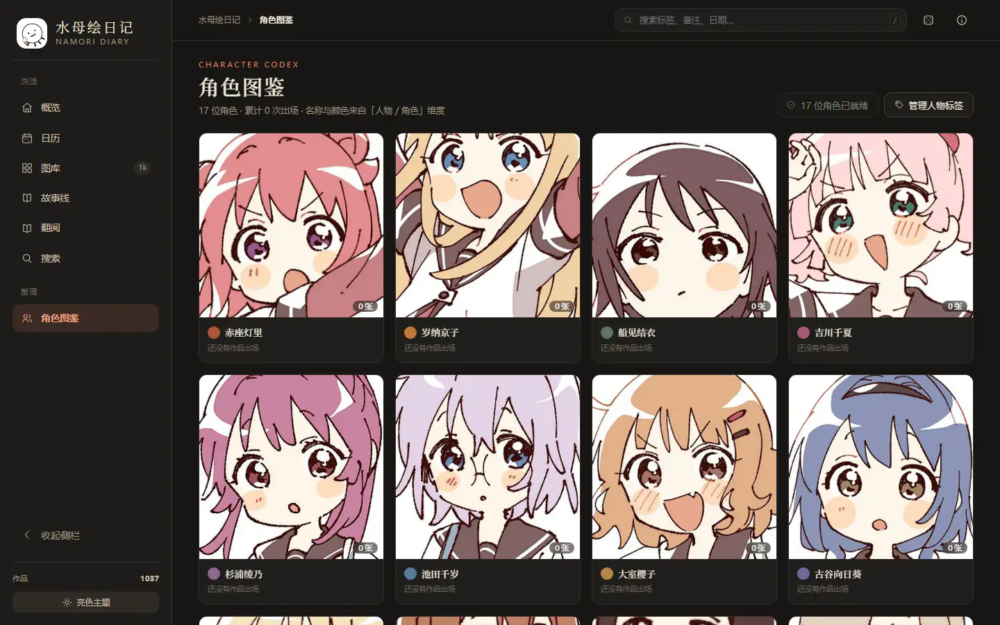
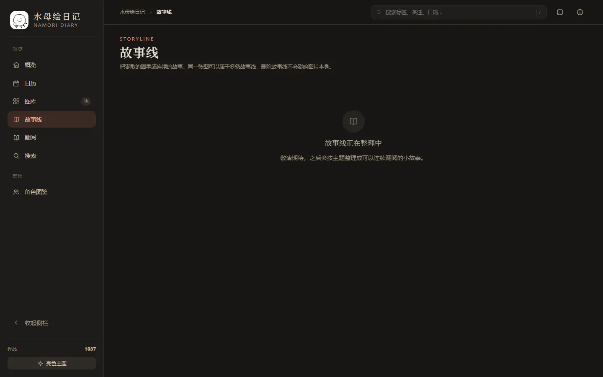
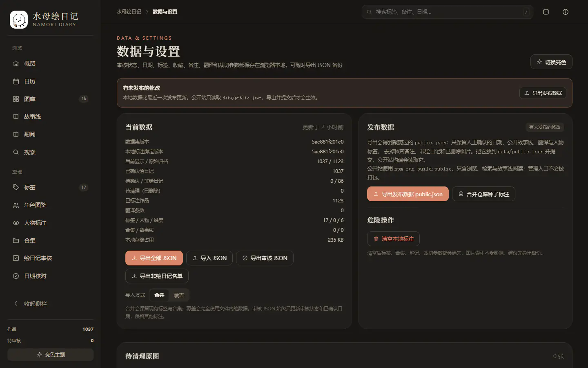
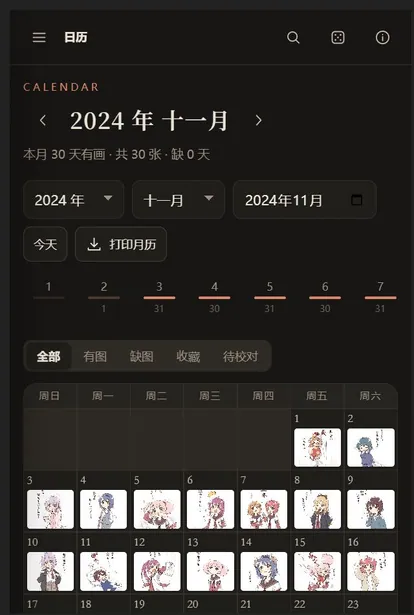

# 水母绘日记 · Namori Diary

[English](README.md) · [中文](README.zh-CN.md) · [日本語](README.ja.md)

> 界面提供中文、日文、英文三种语言，文中引用的是中文界面文案。中文界面站名为「水母绘日记」，日文与英文界面统一使用 **Namori Diary**。

一个纯静态、无后端的前端站点，用来浏览、整理和重读 Namori（[@namoridane](https://www.instagram.com/namoridane)）在 Instagram 发布的每日手绘「绘日记」。

- **收录 1,123 张图**（2021-03 → 2025）：其中 1,037 张确认为绘日记，86 张确认为非绘日记；公开端只收录那 1,037 张
- **一套代码两种构建**：完整的本地 **管理端** 和只读的 **公开端**
- **三语界面**（中 / 日 / 英）：跟随浏览器语言，可随时手动切换并按浏览器记住
- **每张作品独立地址**：History 路由、预渲染静态页与 `404.html` 回退，深链在 GitHub Pages 上也能直接打开
- **本地优先**：标注数据保存在 `localStorage`，可导出 / 导入 JSON；没有后端、数据库和账号
- **纯前端搜索**：多字段、多关键词、错字容错，命中片段高亮，支持键盘操作与最近搜索
- **流式批量下载**：选中的原图自动分卷打包为 ZIP，带进度与取消
- **默认暗色主题**，切到亮色后按浏览器记住选择
- **桌面优先**，首页、日历、图库、翻阅和详情页都做了手机布局
- 内置 17 个《摇曳百合》角色头像占位

## 相关链接

- GitHub 主页 — <https://github.com/payayakamo>
- 站点仓库 — <https://github.com/PayayaKamo/namoridane>
- 小红书 · PayaYa — <https://xhslink.cn/o/AmThiRAG07o>
- 小红书 · @PayayaKamo — <https://xhslink.cn/o/22fet2ONRIv>

---

## 界面截图

以下截图均由实际运行的站点截取（除注明外为公开端构建），不是示意图。

| 首页 | 画历 |
| --- | --- |
|  |  |

| 图库 | 详情（原文案 + 原帖） |
| --- | --- |
|  |  |

| 按日期查 | 翻阅 |
| --- | --- |
|  |  |

| 角色图鉴 | 故事线（公开端空状态） |
| --- | --- |
|  |  |

| 管理端 · 数据与本地写回 | 手机 · 首页 | 手机 · 画历 |
| --- | --- | --- |
|  |  |  |

> 管理端截图只保留写回面板，不含备注、日期校对草稿或本地路径。

---

## 快速开始

```bat
:: Windows 一键启动（首次会安装依赖、生成索引并打开浏览器）
start.cmd
```

或手动：

```bash
npm install
npm run dev          # 增量生成索引后启动 http://localhost:5173/
npm run lint         # ESLint 检查 src/、scripts/ 与 tests/
npm run typecheck    # tsc -b
npm test             # Vitest 运行
npm run build:admin  # 本地管理端 -> dist/
npm run build:public # 只读公开端 -> dist/
npm run preview      # 预览上一次构建
```

需要 Node.js 18+。

`images/original/` 已提交完整图片归档，开箱即可生成完整站点；即使目录为空，两档构建也能通过，并显示带导入命令的「还没有图片」空状态。

### npm 脚本

| 命令 | 用途 |
| --- | --- |
| `npm run data` | 扫描原图，增量生成缩略图、大图、`index.json` 与种子数据 |
| `npm run data:force` | 忽略缓存，重建全部派生文件 |
| `npm run import -- "<dir>"` | 导入新图片目录：哈希去重、可追溯命名，合并进 `images/original/` |
| `npm run import:data -- <file.json> --target=public\|review` | 把导出的 JSON 反向写入 `data/public.json` 或 `data/userdata.json`（校验 + 备份） |
| `npm run ocr` | 可选的 Windows 专用 OCR，为审核页预填日期线索（`data/ocr.json`） |
| `npm run dev` | 先跑 `data`，再启动 Vite 开发服务器（管理端） |
| `npm run lint` | 用 ESLint 检查 `src/`、`scripts/` 与 `tests/` |
| `npm run typecheck` | TypeScript 项目检查（`tsc -b`，不产出文件） |
| `npm test` / `npm run test:watch` | Vitest：筛选、用户数据、索引日期与公开数据裁剪 |
| `npm run build:admin` | 管理端构建：`data` + 类型检查 + `vite build --mode admin` |
| `npm run build:public` | 公开端构建：`data --mode=public` + 类型检查 + `vite build --mode public` + 预渲染页面、sitemap 与 `404.html` |
| `npm run purge` | 永久删除 `images/_trash/` 里等待清理的原图 |
| `npm run preview` | 预览 `dist/` |
| `npm run deploy` | `build:public` 后把 `dist/` 推到 `gh-pages` 分支 |

---

## 两档构建，一套代码

`vite build` 接收 `--mode admin|public`，模式以编译期常量 `__APP_MODE__` 暴露。

| | `build:admin` | `build:public` |
| --- | --- | --- |
| 面向 | 本地自用 | GitHub Pages 访客 |
| 审核、手动日期、角色标注 | 有 | 无 |
| 标签 / 角色 / 翻译编辑 | 有 | 只读展示 |
| 故事线搭建（含 shortcode 建线） | 有 | 只读阅读 |
| 合集、导入导出、排除区、批量操作 | 有 | 无 |
| 本地 JSON 写回 | 仅 dev server | 不参与编译 |
| 收录条目 | 全部 1,123 条 | 仅 1,037 条已确认绘日记 |
| 界面语言 | 中文 / 日文 / 英文 | 中文 / 日文 / 英文 |
| 深链 | dev server 回退 | 每个栏目与作品都有预渲染 HTML，另有 `404.html` |
| 未确认日期 | 作为推测供审核 | 只展示已确认日期 |

管理端专属视图通过编译期守卫懒加载，公开包中不存在管理路由、表单、删除接口或本地写回代码；隐藏发生在组件层面，而不是 CSS。

公开端的空状态一律使用访客文案（「正在整理中，敬请期待」），不出现面向管理员的指引。

---

## 界面语言

所有界面文案都来自 `src/i18n/messages/` 下的中文、日文、英文词条。语言按以下顺序确定：已保存的 `namori.locale`，其次 `navigator.languages`，最后回退到中文。切换语言会立即更新 `<html lang>` 与页面标题，并写入 `localStorage`；侧栏底部是完整切换器，顶栏提供一个紧凑的循环切换。

中文界面站名为「水母绘日记」，日文与英文界面统一显示 **Namori Diary**。数字与日期按当前语言用 `Intl` 格式化，管理端与公开端共用同一套语言选择。

---

## 网址、静态页面与 SEO

导航使用 History API 而不是 hash。每张作品都有独立地址 `/item/<id>/`，主要栏目为 `/`、`/calendar`、`/gallery`、`/reader`、`/search`、`/characters`、`/stats`、`/storylines` 与 `/about`；管理端另有 `/tags`、`/collections`、`/diary-review`、`/review` 和 `/data`。

旧的 `#/item/<id>`、`#/gallery` 等链接在打开时会用 `history.replaceState` 原地改写成新地址（不新增历史记录），页面内的 `href="#/…"` 也会被接管，因此旧分享链接继续可用。

`npm run build:public` 会为每个栏目和每张作品生成独立目录（共 1,037 个作品页），并把对应栏目的 `title`、`description`、canonical、Open Graph 与 JSON-LD 写进 HTML。构建还会输出 `sitemap.xml`（首页、主要栏目、全部作品，含图片条目），并把同一份模板复制为 `404.html`，作为 GitHub Pages 上未知路径在客户端路由接管前的回退。

---

## 发布数据到公开站

公开端构建不读取浏览器数据，只读取已提交的种子文件 `data/public.json`。

### 方式 A：管理端导出 + 写回

1. 打开管理端 **数据与设置**。
2. 点 **导出发布数据 public.json** 导出仅含公开内容的文件（图片、文案、permalink、公开标签、已确认日期、小红书 / 公众号链接）。
3. 在同一页点 **写入 data/public.json**，直接写进仓库——仅在 `npm run dev`（管理端）下可用；正式构建里按钮和 dev 接口都会被编译掉。
4. **写入审核数据** 把完整审核数据写入 `data/userdata.json`（已被 gitignore，含私有内容）。

每次写入都会先把旧文件备份到 `.cache/data-backups/`，校验载荷后原子写入；只允许写 `data/` 目录内的目标文件，任意路径会被拒绝。

### 方式 B：命令行

```bash
npm run import:data -- "C:\Users\me\Downloads\public.json" --target=public
npm run import:data -- "C:\Users\me\Downloads\namori-diary-review.json" --target=review
```

非法或不匹配的数据会直接报错，不会覆盖现有文件；写入前同样会备份。

`data/public.json` 只保留公开字段：备注、拆解笔记、翻译草稿都会被裁剪，日期也只导出已确认项。86 张确认为非绘日记的图片会记入 `excludedIds`，因此公开构建只索引 1,037 条而不是 1,123 条，另外 86 张不会进入公开端。本地数据比上次导出新时，管理端会显示 **有未发布的修改**。

---

## 目录结构

```
namoridane/
├─ images/
│  ├─ original/             # 图片归档（由 npm run import 替换）
│  └─ _trash/               # 已删除、等待清理的原图（gitignored）
├─ data/
│  ├─ public.json           # build:public 使用的发布种子（已提交）
│  ├─ userdata.json         # 完整本地审核数据（gitignored）
│  ├─ userdata.example.json # 管理端种子用的空 schema 示例
│  └─ ocr.json              # 可选 OCR 输出（已提交，仅管理端）
├─ docs/screenshots/        # README 使用的真实截图（WebP）
├─ public/
│  ├─ namori_icon.webp      # 站点图标（另有 PNG 32/48/180/192 与 ICO 回退）
│  ├─ characters/           # 预置角色的 512×512 头像占位
│  ├─ wechat-qr.webp        # 微信公众号二维码（关于页）
│  ├─ og-cover.jpg          # Open Graph 封面图
│  ├─ robots.txt            # 爬虫规则
│  ├─ sitemap.xml           # 基础 sitemap，build:public 时重写
│  ├─ images/thumb/         # 480px WebP 缩略图（生成，gitignored）
│  ├─ images/large/         # 1400px WebP 大图（生成，gitignored）
│  ├─ images/original/      # 供下载的原图副本（生成，gitignored）
│  └─ data/index.json       # 条目索引（生成，gitignored）
├─ scripts/
│  ├─ build-index.mjs       # 原图 → 派生图 → 索引 → 种子
│  ├─ build-static-pages.mjs # 栏目/作品 HTML、元信息、sitemap 与 404.html
│  ├─ import-images.mjs     # 新图片批次的增量导入
│  ├─ import-data.mjs       # 导出 JSON → data/*.json（校验 + 备份）
│  ├─ ocr-dates.mjs         # 可选日期 OCR（仅 Windows）
│  └─ purge-trash.mjs       # 永久清空 images/_trash
├─ src/
│  ├─ components/           # Layout / LocaleSwitch / SearchBar / ItemCard / 各种选择器
│  ├─ i18n/                 # 语言检测与中 / 日 / 英文词条
│  ├─ lib/                  # router、dates、filtering、storage、publish、trash、canvas、
│  │                        # search、流式 ZIP、SEO
│  ├─ state/store.tsx       # 全局状态 + localStorage 持久化
│  ├─ views/                # home、calendar、gallery、detail、review、date-find、characters、
│  │                        # storylines、translations、stats、data、search、about
│  ├─ styles.css
│  └─ styles-views.css
├─ tests/                   # Vitest：筛选、用户数据、索引日期、公开数据
├─ vite.config.ts           # 本地写回用的 dev 专用中间件
└─ .github/workflows/       # ci.yml（质量闸门）与 deploy.yml（Pages）
```

---

## 功能

| 模块 | 说明 |
| --- | --- |
| 品牌与主题 | 站点图标 `namori_icon.webp`（WebP 主图标，PNG/ICO 回退）；站名「水母绘日记 / Namori Diary」；默认暗色且首屏不闪白，切过亮色后按浏览器记住 |
| 界面语言 | 完整的中 / 日 / 英文词条；语言取自保存的选择或浏览器偏好，可在侧栏切换、也可用顶栏的紧凑循环切换，按浏览器记住；`<html lang>`、页面标题与 `Intl` 格式随之变化 |
| 网址与分享 | History 路由，每张作品独立地址 `/item/<id>/`；旧 `#/…` 链接原地改写；预渲染页面带 canonical、Open Graph 与 JSON-LD，另有 `sitemap.xml` 与 `404.html` 回退 |
| 首页 | 作品总数与覆盖年份；**每日一图取同月同日、年份不限**（同一天内确定性选中），卡片标出「某年某月某日」，没有同月同日时回退最近一张已确认绘日记；年度与标签概览 |
| 画历 | 带缩略图的月网格；标题两侧上/下年按钮与 `←` / `→` 切换年份（月份由下方选择器负责，输入框聚焦时不拦截）；月份标题与统计行吸顶；从最早数据年到当前年的连续年份选项卡；首次进入自动定位到有内容的月份（优先同月份的最近年份，其次最近月份），用户手动选择后不再自动跳转 |
| 图库 | 按月份分组的懒加载瀑布流；按有效日期排序；收藏 / 待校对 / 翻译状态筛选；多选批量操作（标签、人物、合集、故事线），以及流式原图 ZIP 下载：显示进度、可取消，按最多 100 张或 100 MB 自动分卷 |
| 详情 | 大图与上一张 / 下一张；发布日期与日记日期分开；原文案与原帖 permalink；小红书 / 公众号链接有值才显示；尺寸、体积、文件名、shortcode；下载；标签、备注、收藏；人物芯片选择器 |
| 出场人物标注 | 复用 `character` 标签维度：可搜索芯片，点选即标记、再点取消，已选排前并高亮，支持 `↑`/`↓` + `Enter`，可就地新建角色；图库多选可批量添加 / 移除同一组角色；角色页出场统计实时更新 |
| 角色图鉴 | 17 个预置头像 + 自建角色；名称、颜色、从图片裁头像或上传；累计出场与最近出场；按角色浏览图库 |
| 翻阅 | 全屏顺序阅读，控制条自动隐藏并支持 Fullscreen API；分段 **全部 / 绘日记**，默认「绘日记」并在手动切换后记住；切换范围时定位到最近条目，不会空白 |
| 按日期查 | 在搜索框输入 `20261117`、`2026-11-17`、`11-17` 或 `11/17`，或点画历某天。结果为纵向单列卡片：日期与星期、发布日期、可复制的 shortcode、原帖 permalink、可折叠原文案、小红书 / 公众号链接；同一日期跨年份时按年纵向排列；支持多选与分享链接 |
| 故事线 | 卡片含封面、标题、简介、张数、日期范围与最近编辑；**按 shortcode 建线**（换行、空格、逗号或完整 Instagram 链接，重复会提示，创建前预览顺序与未匹配项，创建后可调序）；章节备注、封面、标签、连续或滑动阅读、JSON/HTML 导出 |
| 绘日记审核 | 待审 / 绘日记 / 非绘日记 / 全部 队列；大图审核；OCR 候选与裁切预览；推断日期 = 发布日 − 1 天；一键确认；`N` 标非绘日记；`←`/`→` 翻页；进度与剩余数；导出审核 JSON；`/diary-review` 是真实地址 |
| OCR | `npm run ocr` 识别画面上的手写日期并写入 `data/ocr.json`，审核页展示最多三个候选与置信度；仅 Windows、可选，只对清晰的日期文字有效 |
| 搜索与筛选 | 多字段搜索（文案、shortcode、标签、人物、备注、翻译、日期、拆解笔记、合集、文件名）；最多 6 个关键词，按空格或标点切分，默认 AND，无结果时给出放宽建议；错字容错模糊匹配；命中片段高亮；`↑`/`↓` + `Enter` + `Esc` 键盘操作；保留最近 8 次搜索并可清空；可与日期范围、年 / 月、合集、收藏、翻译状态组合，公开端隐藏备注类与「只看未校对」控件 |
| 标签 | 五个内置维度 + 自定义维度；增删改、颜色、使用计数、批量打标签 |
| 翻译 | 日文原文 + 多语言槽位；OCR 草稿供校对；已译 / 未译筛选；CSV/JSON 导入导出 |
| 合集 | 命名合集、多选加入、拖拽排序、封面、浏览、导出 md/json/csv |
| 临摹拆解 | 构图 / 配色 / 线条 / 表情备注，自动取色，相似图推荐 |
| 统计洞察 | 概览卡片（作品数、作画天数、最长连续、审核进度）；月度柱状、年度概览与标签分布；角色排行；**人物组合** 环形图，分「单人 / 双人 / 多人」标签页并写明统计口径；**角色共现矩阵** 可在「主要角色（占全部绘日记 ≥5%）/ 全部角色」之间切换，颜色越深共现越多，附最高共现组合，点格子可筛选，超过 10 个角色时自动切换紧凑排版；**关系热力环** 按出场数排布，连线越粗表示共同出镜越多，悬停高亮、点击筛选；每位角色的 **首末登场** 并可跳转到对应作品；**标签演变** 按年统计，每个维度取前 8；**文本画像** 统计文案长度、高频词与 emoji；**数据可信度** 展示已确认 / 推断 / 缺失占比与跨月、跨年提示 |
| 关于与联系 | 关于页提供 GitHub 主页、站点仓库、两个小红书账号与微信公众号二维码（悬停或点击展开）；站点信息列出版本号、构建时间、作品数、覆盖年份、角色数与标签数；页脚重复 GitHub 与小红书入口 |
| 数据与设置 | 完整标注 JSON 导入导出（合并或替换）、审核 JSON、翻译 CSV/JSON、发布种子导出、**仅 dev 的本地写回**、本地存储用量、待清理列表、重置、schema 与快捷键；当存储已满、损坏或不可用时，横幅会说明原因并提供 **导出完整标注 JSON** 与 **重试保存** |
| 手机布局 | 可收缩的顶栏搜索、仍显示缩略图的紧凑画历、整行等分的翻阅分段控件、不使用固定 100vh、触摸时无蓝色高亮 |

### 键盘快捷键

| 按键 | 作用 |
| --- | --- |
| `←` / `→` | 详情与翻阅中切换上一张 / 下一张；画历中切换上 / 下一年（输入框聚焦时不拦截） |
| `Esc` | 关闭详情、弹窗或手机搜索面板 |
| `/` | 聚焦全局搜索 |
| `↑` / `↓` | 搜索框展开时在候选间上下移动 |
| `R` | 随机一张 |
| `F` | 收藏当前图 |
| `Enter` | 审核页确认并前进；选择器中按输入新建或添加 |
| `N` | 审核页标记为非绘日记 |
| `1` / `2` | 详情页切换 信息 / 拆解 |
| `?` | 快捷键面板 |

---

## 图片来源与命名

`scripts/build-index.mjs` 按以下顺序解析来源目录：

1. 命令行参数：`--src="D:\path\to\images"`
2. 环境变量：`NAMORI_SRC`
3. 仓库归档：`images/original/`（为空时自动创建）

文件名必须可追溯：

```
YYYY-MM-DD-<11 位 shortcode>[-n].jpg
unknown-<原始文件名>.jpg
```

前缀是 Instagram **发布日**（`publishedAt`）。多图帖子用 `-0 / -1 / …` 后缀，流水线会计算 `postCount` 和稳定的 `id`；原文案存为 `caption`，原帖链接由 shortcode 推导。

### 日期规则

- 发布日来自文件名。
- 画面上的手写日记日期必须由人工确认，不会被静默猜测。
- OCR 最多给出三个带置信度的候选，年份按最接近发布日推断；OCR 只是线索，不是事实。
- 没有可用 OCR 结果时，审核页预填 **发布日 − 1 天** 并标注 **推测**（跨月、跨年会正确进位）。
- 只有已确认日期会进入 `data/public.json`，公开端不会把推测当作日期。

---

## 数据结构

### 1. 条目索引 — `public/data/index.json`

由构建生成，前端只读：

```jsonc
{
  "version": 9,
  "generatedAt": "2026-11-17T00:00:00.000Z",
  "datasetId": "…",
  "count": 1123,
  "years": { "2021": 258, "2022": 401, "2023": 155, "2024": 308, "2025": 1 },
  "items": [
    {
      "id": "2021-06-01-CPlLQUStuZq",
      "shortcode": "CPlLQUStuZq",
      "file": "2021-06-01-CPlLQUStuZq.jpg",
      "postIndex": 0,
      "postCount": 1,
      "category": "diary",                 // diary = 已确认绘日记，other = 已确认为非绘日记
      "includedInPublic": true,            // 86 张非绘日记为 false
      "publishedAt": "2021-06-01",
      "dateKnown": true,
      "inferredYear": 2021,
      "inferredMonth": 5,
      "inferredDay": 31,
      "caption": "#ゆるゆり活動日記 …",
      "thumb": "images/thumb/2021-06-01-CPlLQUStuZq.webp",
      "large": "images/large/2021-06-01-CPlLQUStuZq.webp",
      "original": "images/original/2021-06-01-CPlLQUStuZq.jpg",
      "w": 1080,
      "h": 1350,
      "color": "#e8dccb",
      "ocr": { "rawText": "5月31日", "candidates": [] },
      "suggestedDiaryDate": { "year": 2021, "month": 5, "day": 31 }
    }
  ]
}
```

`category` / `includedInPublic` 来自 `data/public.json` 的审核结论（`excludedIds`）：管理端构建保留全部 1,123 条，公开端构建会过滤掉所有 `includedInPublic: false` 的条目，因此只索引 1,037 张已确认绘日记。

公开模式下会剥离 `inferred*`、`ocr`、`suggestedDiaryDate`，但保留 `caption` 与 `shortcode`，供详情页显示原文案与原帖。

### 2. 用户数据 v2 — `localStorage` / 导入导出

存储键：`namori.diary.userdata.v2`。完整类型见 [`src/types.ts`](src/types.ts)。

```jsonc
{
  "version": 2,
  "datasetId": "…",
  "dimensions": [{ "id": "character", "name": "人物/角色", "order": 0, "builtIn": true }],
  "tags": [{ "id": "t_xxx", "name": "赤座灯里", "dimensionId": "character", "color": "#c96f4a" }],
  "characters": [{ "id": "t_xxx", "avatarItemId": "…", "avatarCrop": { "cx": 0.5, "cy": 0.5 } }],
  "collections": [{ "id": "c_xxx", "name": "临摹参考", "itemIds": ["…"] }],
  "storylines": [{
    "id": "story_xxx",
    "title": "夏日的一周",
    "blocks": [
      { "id": "block_1", "type": "image", "itemId": "…" },
      { "id": "block_2", "type": "note", "text": "第二章：雨天" }
    ],
    "published": true
  }],
  "items": {
    "2021-06-01-CPlLQUStuZq": {
      "tags": ["t_xxx"],
      "favorite": true,
      "reviewed": true,
      "excluded": false,
      "note": "私有备注",
      "date": { "year": 2021, "month": 5, "day": 31, "confirmed": true, "source": "manual" },
      "study": { "composition": "", "palette": "", "memo": "" }
    }
  }
}
```

- 审核状态由 `reviewed` + `excluded` 组合：`false/false` 待审、`true/false` 确认绘日记、`true/true` 确认非绘日记。
- `deleted` 会让条目从所有视图和发布种子中消失，原图先移入 `images/_trash/`。
- `date.source` 取值 `inferred` / `published` / `manual`；只有 `confirmed: true` 才会出现在公开端。
- 出场人物就是 `character` 维度上的普通标签，没有并行的第二套数据。

以上示例值仅作示意，实际数据以你自己录入的名称为准。

### 数据集版本与重置

`index.json` 带有基于文件列表与字节数计算的 `datasetId`。当 id 变化（新导入、删除图片）时，应用会丢弃旧标注并重新开始。**数据与设置 → 清空本地标注** 可随时重置。发布种子不含 `datasetId`，公开端加载后与公开索引绑定。

---

## 增量构建

- 缓存：`.cache/images.json`，键为 `file:target-size:mtime`。
- 再次运行 `npm run data` 会复用未变图片，通常一秒内完成。
- 用 `npm run data:force` 强制重建。
- 审核与标注不会改动图片归档，只有增删源文件才会改变索引。

---

## 新增一批图片

```bash
npm run import -- "C:\path\to\new\images"
```

脚本同时支持普通图片目录和 **Instagram 保存页目录**。

1. 递归扫描 `.jpg` / `.jpeg`，忽略页面资源与 PNG/WebP 界面图。
2. 解析内嵌页面 JSON、GraphQL 响应与 base64 `_DataURI` 中的 `shortcode`、`taken_at`、图片地址与文案。
3. 去重使用文件内容 SHA-256；已存在或批内重复的文件会跳过。
4. 无法恢复日期的图片命名为 `unknown-<shortcode>.jpg`，留在待审队列等待人工填日期。
5. 只复制文件，不修改源目录；重复导入同一目录是幂等的。

然后运行 `npm run data`（或直接构建）生成派生图并更新索引。

---

## 审核绘日记日期（原图永不修改）

1. 在管理端打开 **绘日记审核**（`/diary-review`）；旧的 `#/diary-review` 会自动改写。
2. 有 OCR 结果时预填候选，否则预填 **发布日 − 1 天** 并标注 **推测**。
3. 按 `Enter` 确认并跳到下一张；按 `N` 标记为非绘日记；用 `←` / `→` 翻页。
4. 进度行显示 已确认 / 总数 与剩余数。
5. 可导出审核 JSON 备份或恢复；导入只更新审核状态与确认日期。
6. 用 **写入 data/public.json** / **写入审核数据**（dev）或 `npm run import:data` 回写结果。

整个流程不会裁剪、改名、覆盖或删除原图。

---

## 删除无关图片

1. 在详情页或图库多选中点 **删除**。
2. 确认弹窗后，条目立刻从所有视图和发布种子中消失，原图移入 `images/_trash/`。
3. 短时间内的 **撤销** 提示可以把原图恢复回来。
4. 在 **数据与设置 → 待清理原图** 中逐条 **恢复**，或 **执行清理** 永久删除（也可运行 `npm run purge`）。

公开端构建不包含删除接口或删除代码路径。

---

## 质量闸门

以下四条命令在本地与 CI 中完全一致：

| 命令 | 检查内容 |
| --- | --- |
| `npm run lint` | 用 ESLint 检查应用、脚本与测试 |
| `npm run typecheck` | TypeScript 项目检查（不产出文件） |
| `npm test` | 4 个 Vitest 套件、50 个用例：图库筛选、用户数据规范化、索引日期推断与公开数据裁剪 |
| `npm run build:public` | 与实际部署完全一致的产物，含数据裁剪、预渲染页面与 sitemap |

`.github/workflows/ci.yml` 会在每个 Pull Request 以及非 `main` 分支的推送时运行上述流程；`.github/workflows/deploy.yml` 在 `main` 上再跑一遍后才上传 Pages 产物，任何一步失败都会阻止部署。

---

## 部署到 GitHub Pages

仓库：<https://github.com/PayayaKamo/namoridane.git>

`vite.config.ts` 使用 `base: './'`，因此无需改动即可部署在 `https://<user>.github.io/<repo>/` 下。

`.github/workflows/deploy.yml` 先跑质量闸门，再用 `npm run build:public` 构建，把 `dist/` 作为 Pages 产物上传，并通过 `actions/deploy-pages` 发布。产物包含每个栏目与每张作品的 HTML，以及 `sitemap.xml`、`robots.txt` 和 `404.html` 回退。

1. 仓库 **Settings → Pages → Build and deployment → Source** 选择 **GitHub Actions**。
2. 推送 `main` 并等待工作流完成。
3. 打开 <https://payayakamo.github.io/namoridane/>。

推送前请确认 `data/public.json` 已提交，否则公开构建没有数据。

---

## 说明与限制

- OCR 可选且仅支持 Windows（PowerShell WinRT，无额外依赖），只是审核辅助，日期始终由人工确认。
- Instagram 评论没有抓取，站点不会伪造评论，也不会留下空评论区。
- 日期只有在确认后才会发布，推测永远不会以事实形式出现在公开端。
- 语言按浏览器选择（`namori.locale`）或浏览器偏好决定，没有服务端语言协商。
- 标注数据受浏览器 `localStorage` 容量限制。管理端会显示当前用量，保存失败时提示并提供 JSON 备份；数据较多时应及时导出并清理。
- 部署产物包含原图与 WebP 派生图（约 260 MB）。如需更轻量，可在 `scripts/build-index.mjs` 调整大图尺寸或去掉原图，代价是失去下载功能。

---

## 版权

所有插画版权归 Namori 所有。本仓库仅用于个人浏览、学习与临摹参考，请勿商用或二次分发原图。

## 许可

本仓库的源代码以 [MIT 许可证](LICENSE) 公开。插画及原图的版权归 Namori 所有，**不在**该授权范围内，不得再分发原图。
